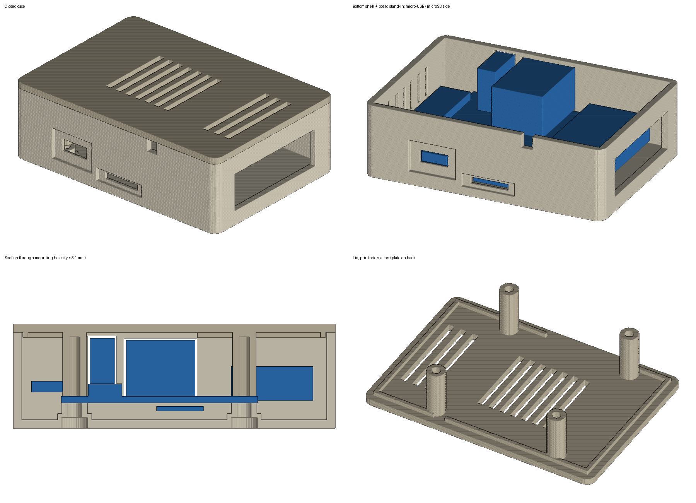

# Orange Pi Zero LTS case

A 3D-printable two-part enclosure (bottom shell + lid) for the
[Orange Pi Zero LTS](http://www.orangepi.org/html/hardWare/computerAndMicrocontrollers/details/Orange-Pi-Zero-LTS.html),
designed for a board whose 26-pin header uses right-angle pins running into a
female connector off the side of the board, and whose 13-pin header pins point
sideways.



## Files

| File | What it is |
|---|---|
| `opiz_case_bottom.stl` | Bottom shell with a cable slot in the end of the side connector bay |
| `opiz_case_bottom_closed_bay.stl` | Same bottom shell, with the side bay closed (use if nothing plugs into the connector) |
| `opiz_case_lid.stl` | Lid with screw posts, locating lip and vent slots |
| `opiz_case_preview.png` | Renders: closed case, ports side, cross-section, lid |
| `opiz_case.py` | Parametric generator that produces the STLs |

Print **one** bottom shell (open or closed bay) and the lid.

## Features

- Outer size about **75.7 × 52.7 × 24.6 mm** closed.
- Openings for micro-USB (with a recess so a thick plug fits), microSD (with a
  finger notch), Ethernet and USB-A.
- Side bay (16 mm past the board edge) for the 26-pin right-angle connector.
- 9 mm clearance on the opposite side for sideways 13-pin header pins.
- Notch at the top of the wall for the Wi-Fi antenna wire.
- Vent slots in the lid (over the SoC and the connector bay) and on the 13-pin side wall.
- 0.3 mm clearance around the PCB, 0.5 mm around each port.

## Assembly

Board mounting: the board sits on four short posts and is held by four M3
screws. Each screw goes up through the bottom (heads sit in counterbores),
through the board's corner holes, and into a post on the lid. M3×12 to M3×16
self-tapping screws will work.

1. Fit the side connector and route the antenna wire through the notch.
2. Drop the board onto the posts in the bottom shell.
3. Put the lid on (the lip locates it), flip the case over, and drive the four screws.

## Printing

- Bottom shell: open side up. Lid: flat side down, posts pointing up.
- No supports needed.
- 0.2 mm layers are fine. PLA works; PETG is a better choice if the case sits somewhere warm.

## Customizing

The STLs are generated by `opiz_case.py`, which needs only Python 3 and numpy.
Edit the parameters at the top of the script, then run:

```sh
python3 opiz_case.py            # writes the STLs to the current folder
python3 opiz_case.py out/       # or to another folder
```

Useful parameters (all in mm):

| Parameter | Default | Controls |
|---|---|---|
| `BAY_OUT` | 16.0 | How far the 26-pin side connector sticks out past the board edge |
| `BAY_SLOT` | `True` | Cable slot in the end of the side bay (`False` closes it) |
| `BAY_SLOT_Y`, `BAY_SLOT_Z` | (6, 42), (-3, 9) | Slot span along the edge and height relative to the PCB top |
| `PIN13_CLEAR` | 9.0 | Clearance for sideways 13-pin header pins (set ~1 if they point up) |
| `PCB_BELOW` | 4.0 | Standoff height under the board |
| `PCB_ABOVE` | 15.0 | Space between the board and the lid |
| `GAP` | 0.3 | Clearance between the PCB edge and the inner walls |
| `PG` | 0.5 | Clearance around each port opening |
| `WALL`, `FLOOR`, `LID_T` | 2.0 | Wall, floor and lid thickness |
| `SCREW_CLEAR_D`, `SCREW_TAP_D` | 3.3, 2.6 | M3 clearance hole (bottom) and self-tap hole (lid posts) |
| `STEP` | 0.2 | Resolution of round features (smaller = smoother, bigger files) |

The script builds the parts from boxes and cylinders on a grid, so round edges
are fine steps rather than true curves. Output meshes are watertight.
Running it with `BAY_SLOT = True` writes `opiz_case_bottom.stl`; to regenerate
the closed-bay variant, set `BAY_SLOT = False` and rename the output.

## Fit notes

The side connector bay and the 13-pin clearance were sized from photos, not
measured. If the connector sticks out more than ~16 mm or is taller than ~10 mm,
or if the 13-pin header pins point straight up instead of sideways, those
dimensions should be adjusted (see Customizing).

## Credits

Board outline, mounting hole and port positions are based on measurements from
Phil Dubach's [OrangePiZeroCase](https://github.com/phildubach/OrangePiZeroCase)
(CC BY-NC-SA 4.0). This design is shared under the same license.
